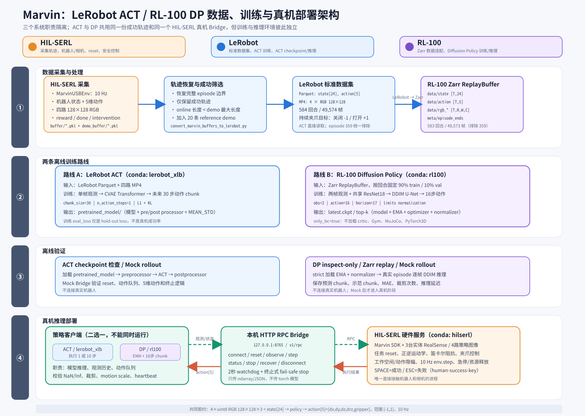

# Marvin ACT / DP 架构图说明



## 三个系统分别负责什么

| 系统 | 主要职责 | 不负责 |
|---|---|---|
| HIL-SERL | 原始轨迹采集、Marvin SDK、RealSense、任务 reset、10 Hz 控制、运动学、工作空间限制、夹爪和急停 | 不训练 ACT/DP，不加载策略 checkpoint |
| LeRobot | 将成功轨迹标准化为 Parquet+MP4、持续夹爪标签转换、ACT 训练、ACT pre/post processor 和推理 | 不直接访问 Marvin SDK 和相机驱动 |
| RL-100 | 将 LeRobot 数据转换成 Zarr、训练 Diffusion Policy、保存 model/EMA/normalizer、离线 replay 和 DP 推理 | 当前 2D BC 不需要 MuJoCo、Gym、PyTorch3D，也不直接访问相机 |

## 数据如何流转

```text
HIL-SERL buffer/demo_buffer
  → 成功完整轨迹筛选
  → LeRobot Parquet + 四路 MP4
      ├→ ACT 训练 → pretrained_model
      └→ Zarr 转换 → RL-100 DP 训练 → latest/top-k ckpt
```

ACT 与 DP 使用同一批成功轨迹、同样的四路图像、24维状态和5维动作，因此可以进行相对公平的策略对比。episode 359 在两条训练路线中都被排除。

## 真机时如何交互

真机阶段由两个进程组成：

```text
策略客户端（lerobot_xlb 或 rl100）
  ⇄ localhost HTTP RPC
HIL-SERL Bridge（hilserl）
  ⇄ Marvin SDK / RealSense / Gripper
```

- Bridge 向策略端返回四路图像、24维 state、reward 和终止信息。
- 策略端只返回5维归一化 action。
- ACT 与 DP 客户端不能同时控制同一个 Bridge。
- HIL-SERL 是唯一接触真实硬件的层；模型环境崩溃时 Bridge watchdog 会执行终止式 stop。
- DP 推理端使用 heartbeat，避免较慢的 DDIM 推理被2秒 watchdog误判为失联。
